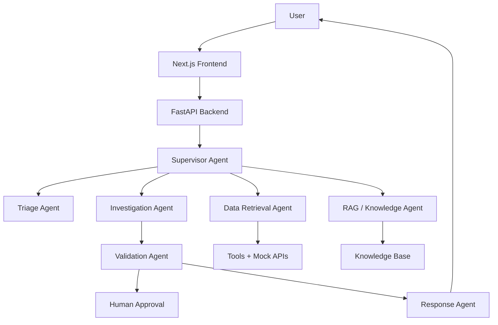
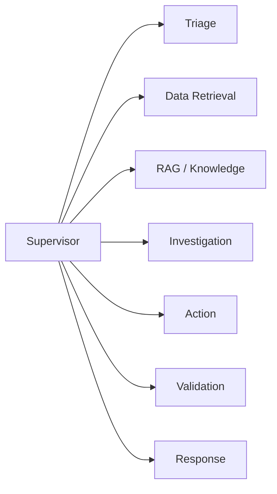
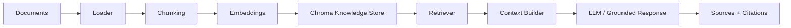

# Delivery Support Resolution Agent

A production-style, multi-agent AI support application for retail delivery issue resolution. The system combines triage, document-grounded retrieval, structured investigation, action gating, and human approval workflows to resolve customer delivery cases with evidence-backed decisions.

## Business Problem

Customers often report late deliveries, lost parcels, refund requests, or unclear carrier statuses. Support teams need a fast, grounded workflow that can:

- classify the type of issue,
- retrieve operational data and policy guidance,
- determine whether a case warrants a refund or escalation,
- confirm if additional approval is required,
- provide a clear response with reference to policy and evidence.

## Features

- Multi-agent orchestration with specialized roles
- Shared typed workflow state
- Retrieval-Augmented Generation using a local knowledge base
- Structured outputs for triage, investigation, validation, and response
- Human approval for consequential actions
- REST API backend with FastAPI
- Next.js frontend dashboard for workflow visibility
- Local Docker setup for backend, PostgreSQL, Redis, and Chroma-style vector store
- Evaluation-ready architecture and sample synthetic data

## Architecture



## Agent Architecture



## RAG Architecture



## Multi-Agent Workflow

This project follows a LangGraph-style state graph with shared state.

1. Triage intent and classify urgency.
2. Retrieve operational data from mock APIs and order records.
3. Search policy documents via built-in retrieval.
4. Investigate the issue using evidence from both structured data and policy docs.
5. Validate groundedness and action safety.
6. Pause for human approval when required.
7. Produce a final reply with known facts, evidence, and citations.

## Technology Stack

- Frontend: Next.js, TypeScript, Tailwind CSS
- Backend: FastAPI, Pydantic
- Agent orchestration: LangGraph-style state graph
- LLM: OpenAI-compatible API with environment-based config
- Vector storage: ChromaDB-oriented local knowledge layer
- Database: PostgreSQL / SQLite fallback-ready design
- Caching / state: Redis-ready structure
- Testing: Pytest
- Containerization: Docker + docker-compose

## Project Structure

```text
.
├── backend/
│   ├── app/
│   │   ├── agents/
│   │   ├── config.py
│   │   ├── graph/
│   │   ├── main.py
│   │   ├── models/
│   │   ├── prompts/
│   │   ├── rag/
│   │   ├── services/
│   │   ├── tools/
│   │   └── __init__.py
│   └── requirements.txt
├── data/
│   └── knowledge_base/
├── frontend/
│   ├── app/
│   ├── components/
│   ├── package.json
│   └── ...
├── .env.example
├── .gitignore
├── docker-compose.yml
├── Dockerfile
├── README.md
└── ...
```

## Installation

### 1. Clone the repo

```bash
git clone <your-repo-url>
cd Bhanu_Resume_project
```

### 2. Python environment

```bash
cd backend
python -m venv .venv
source .venv/bin/activate
pip install -r requirements.txt
```

### 3. Frontend dependencies

```bash
cd frontend
npm install
```

### 4. Environment variables

Copy the example environment file and update values:

```bash
cp .env.example .env
```

## Running Locally

### Backend

```bash
cd backend
uvicorn app.main:app --reload --host 0.0.0.0 --port 8000
```

### Frontend

```bash
cd frontend
npm run dev
```

### Docker

```bash
docker-compose up --build
```

## API Endpoints

- GET /api/health
- GET /api/metrics
- POST /api/chat
- POST /api/agent/run
- POST /api/documents/upload
- POST /api/documents/ingest
- GET /api/sessions/{session_id}
- GET /api/workflows/{workflow_id}
- POST /api/approval/{workflow_id}

## Sample Request

```bash
curl -X POST http://localhost:8000/api/chat \
  -H "Content-Type: application/json" \
  -d '{
    "query": "My order ORD-4401 is delayed and I want a refund.",
    "session_id": "session-001",
    "user_id": "user-001"
  }'
```

## Testing

```bash
cd backend
pytest -q
```

## Evaluation

The project is structured for evaluation on:

- intent classification accuracy,
- retrieval relevance,
- groundedness,
- citation correctness,
- tool selection,
- action safety,
- human escalation correctness,
- response usefulness,
- latency.

Sample synthetic cases are included in the knowledge and workflow logic for local testing.

## Deployment

This repository is prepared for local deployment and future cloud deployment:

- Frontend: Vercel-ready Next.js app
- Backend: Docker-ready FastAPI service
- Data layer: PostgreSQL + Redis + vector knowledge layer

## Limitations

- This is a local demo implementation with mock operational data rather than proprietary production data.
- The frontend is intentionally lightweight and is designed to be extended for more advanced workflows.
- LLM behavior depends on the configured OpenAI-compatible endpoint and network access.

## Future Enhancements

- Real PostgreSQL schema and SQLAlchemy models
- Full ChromaDB ingestion and metadata filtering
- Real LangSmith or OpenTelemetry tracing
- Authentication and role-based access control
- Richer human review dashboard and admin analytics
- Automated evaluation harness with labeled datasets
